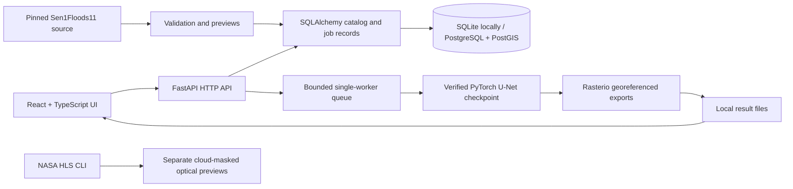

# Architecture and engineering decisions

The backend serves the compiled frontend, keeping API and assets on one origin.
The map uses installed images with geographic corner coordinates, a footprint,
scale and coordinates. There is no paid basemap or external tile dependency.
Layers show optical/radar imagery, predicted water and reference labels.

## Why a small monolith

This project does not need microservices. Scene validation, training and inference
live in separate Python modules that can be inspected and tested. API code delegates
inference to a dedicated service. Future environmental modules should register their
own sensor/input contract and interpretation rather than reusing incompatible models.

A single worker bounds CPU usage and a four-job queue rejects excess work. Jobs
are stored before submission. Startup marks unfinished jobs failed with a clear
restart message. This is intentionally one API process (`--workers 1`); it is not
a distributed durable queue. For multi-user/production work replace it with a
persistent worker queue before increasing API workers. The API currently has no
user authentication and is intended to bind to loopback, not the public Internet.

## Persistence

Alembic creates regions, dataset provenance, scenes, model versions, analysis jobs
and results. Big rasters stay on disk. SQLite offers the lowest-friction local
start. PostgreSQL uses PostGIS for region footprints and a GiST index; a spatial
intersection query was tested. `/scenes?bbox=...` currently uses portable bounding-box
filtering; it is not advertised as a PostGIS-powered endpoint.

Migrations run during single-process application startup. All configuration comes
from the process environment: `DATABASE_URL`, `TERRASENSE_DATA_DIR`, and
`TERRASENSE_MODEL_DIR`. Paths inside manifests are resolved relative to the project
root and restricted to the configured data directory. No upload/remote arbitrary
file execution endpoint is provided. Asset names and output IDs are whitelisted.
A model is a trusted locally generated artifact, checked by SHA-256, loaded with
PyTorch `weights_only=True`.

## Scientific contract

The model detects surface water. There is no before/after reference subtraction,
verified flooding, affected population, road closure or damage estimate.
Outputs retain CRS, affine transform, and nodata (255). Geodesic area uses WGS84
pixel quadrilaterals, not an assumed constant 10 m pixel size. Prediction threshold
is 0.5 and is not a calibrated confidence measure. SAR speckle, terrain shadows,
vegetation and dark surfaces can cause false positives/negatives.

HLS is an optical ingestion path. Its reflectance and cloud-mask handling do not
make it compatible with a two-channel radar network. Prithvi work is deferred
until an event-disjoint baseline has been validated.
